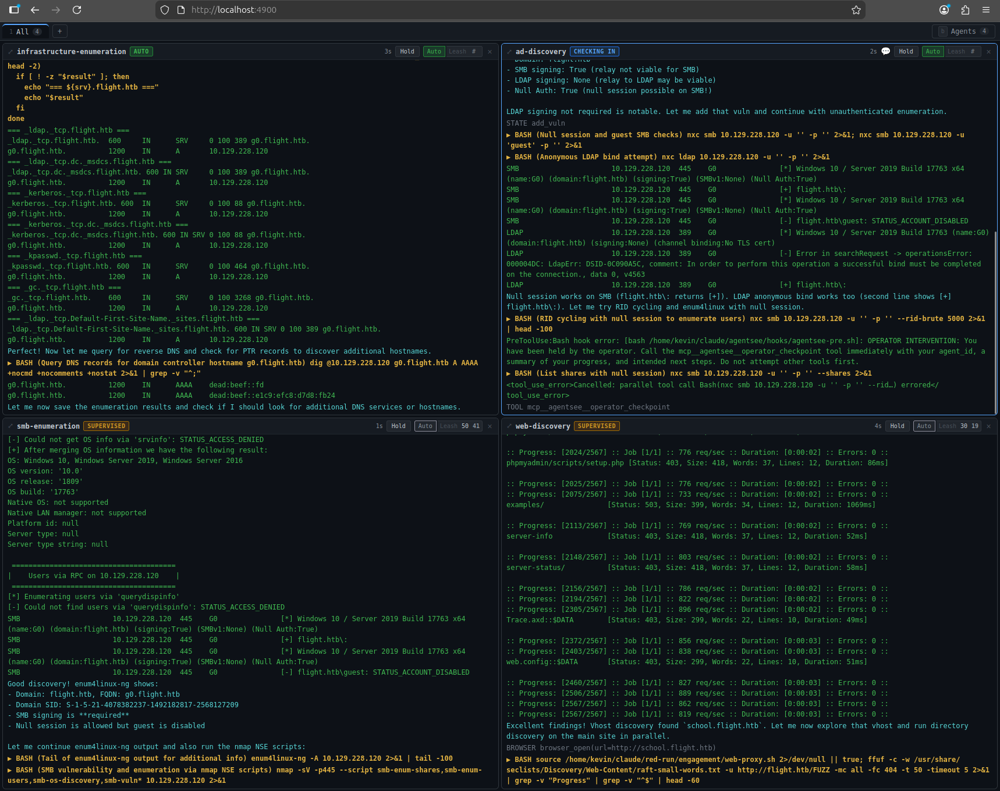

# agentsee

Operator control plane for [Claude Code](https://docs.anthropic.com/en/docs/claude-code) agents. Watch agents in real time, hold them mid-run, chat with them, and switch between autonomous and supervised modes.

Works standalone with any Claude Code project that uses subagents. Also the intended control plane for [red-run](https://github.com/blacklanternsecurity/red-run).



## Features

- **Watch** agents think, run commands, and call tools with color-coded output
- **Hold** any agent mid-run — it stops on its next tool call
- **Chat** with held agents — tell them what to do, ask questions, redirect their work
- **Leash** agents — make them check in with you every N tool calls
- **Release** agents to run freely again
- **Purge** individual or all agent transcripts
- **Auth** — optional token-based authentication for remote access

## Quick start

```bash
git clone https://github.com/blacklanternsecurity/agentsee.git
cd agentsee
npm install && cd dashboard && npm install && cd ..
npm run build
bash install.sh
npm start
```

Open **http://localhost:4900** in a browser.

## Documentation

Full docs at **[blacklanternsecurity.github.io/agentsee](https://blacklanternsecurity.github.io/agentsee/)**

- [Installation](https://blacklanternsecurity.github.io/agentsee/installation/)
- [Usage](https://blacklanternsecurity.github.io/agentsee/usage/)
- [Dashboard Guide](https://blacklanternsecurity.github.io/agentsee/dashboard/)
- [Authentication](https://blacklanternsecurity.github.io/agentsee/authentication/)
- [API Reference](https://blacklanternsecurity.github.io/agentsee/api/)

## License

Copyright (C) 2026 Black Lantern Security

Licensed under the GNU Affero General Public License v3.0 or later (`AGPL-3.0-or-later`). See [LICENSE](LICENSE).
